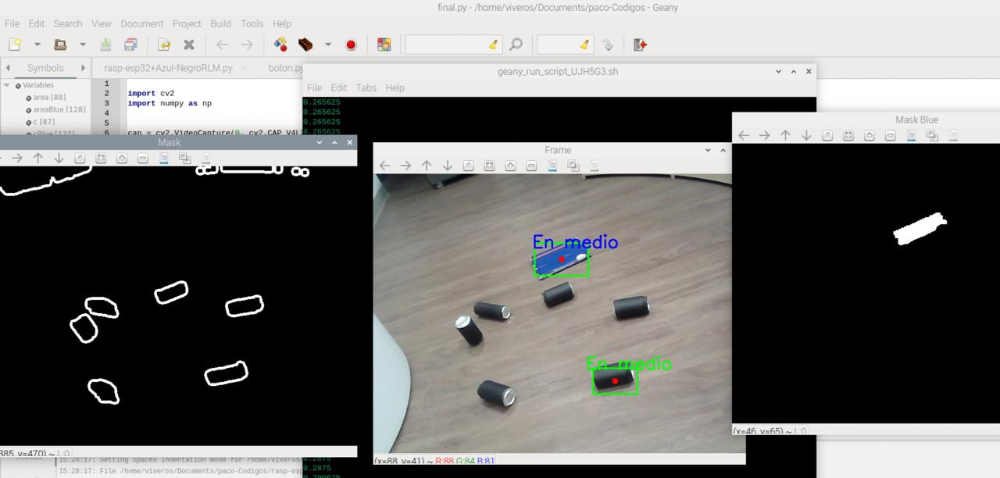
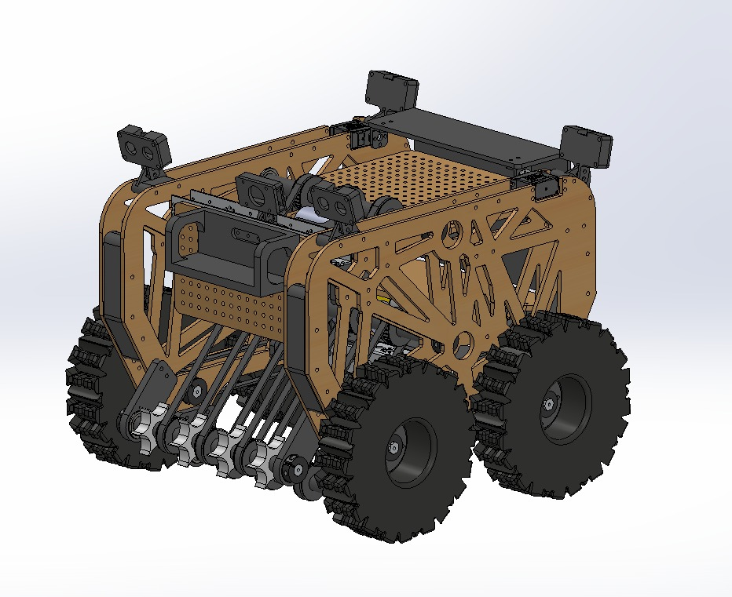
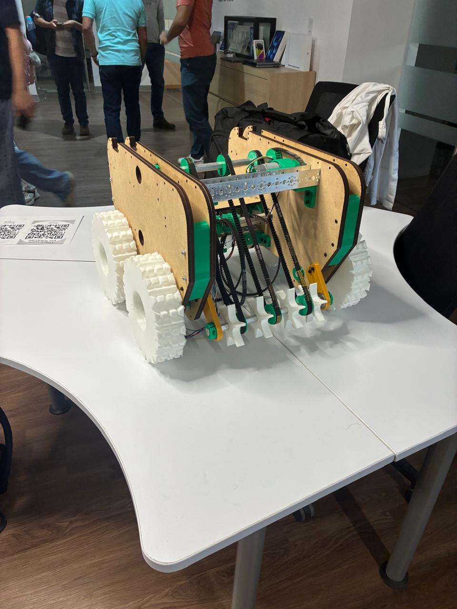
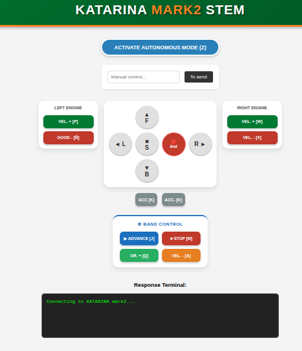
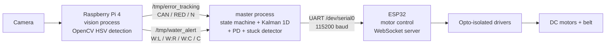
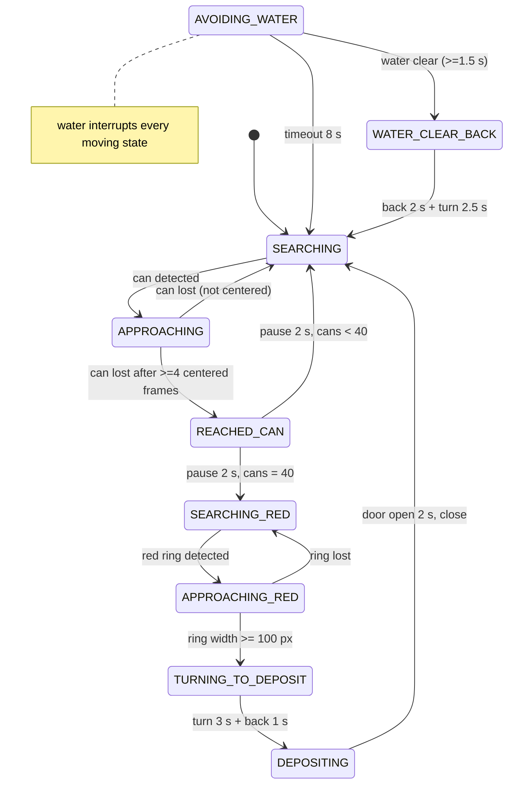

# 🤖 KATA-bot: Autonomous Waste Collection Robot

> 🏆 **5th place nationally, Mexican Robotics Tournament (TMR) 2026, "Beach Can Collection" category**

<p align="center"></p>

**What it does:** KATA-bot drives on sand by itself. It finds cans with a camera, collects them, carries them to the red deposit ring and unloads them, and it backs away from water.

[](https://opensource.org/licenses/MIT)
[](https://www.python.org/)
[](https://isocpp.org/)
[](docs/README.md)
[]()

**KATA-bot** is an advanced autonomous robotics platform developed for the **Mexican Robotics Tournament (TMR)** in the "Beach Can Collection" category. This project integrates real-time computer vision, robust embedded systems architecture, and wireless telemetry to solve environmental cleanup challenges.

---

## 📸 Project Gallery

### Hardware & Development
    
    

### 📹 Technical Demos
Watch KATA-bot in action:

#### 1. Autonomous Navigation & Pathfinding
|  |  |

#### 2. Computer Vision Pipeline (OpenCV Detection)


#### 3. Remote Wifi WebSocket ESP-32 Server FULL CONTROL 


---

## 🛠️ Technical Specifications

* **Computer Vision:** Real-time processing on **Raspberry Pi 4** using OpenCV for target detection through HSV color filtering and contour analysis.
* **Embedded Architecture:** Robust dual-unit system using **ESP32 MCUs** with opto-isolators for driver protection and relay-based power management for high-torque motors.
* **Web-Based Control:** Custom **WebSocket-based HTML interface** hosted locally on the ESP32, enabling real-time manual override and telemetry.
* **Remote Monitoring:** Established wireless remote access via **VNC/SSH** for system debugging and live camera feed visualization.
* **Power Systems:** Managed high-current DC motor draws with a custom-engineered electronic safety layer.

## 🧭 System Architecture



- **Vision** auto-calibrates the black threshold. It detects cans (black, validated by area and shape), the red deposit ring and water (blue pixel ratio with hysteresis, plus the side it is on), and writes the results to two named pipes.
- **Master** runs the mission state machine at about 12 Hz. It smooths the centering error with a 1D Kalman filter and steers with a PD controller (Kp = 24, Kd = 5). A watchdog reconnects the serial link if it drops. A stuck detector backs up and escapes after the same command has been sent for 40 s.
- **ESP32** offers manual control over Wi-Fi (WebSocket) and, in autonomous mode, applies proportional differential steering from the Pi's corrections.

The code follows a **ports-and-adapters (hexagonal) architecture** that applies the **SOLID** principles: the algorithms and the state machine do not depend on OpenCV capture, pipes, serial ports or Arduino APIs, so they are tested on a PC. Full documentation uses the **RUP 4+1 view model**: see [docs/](docs/README.md).

## 🔁 State Machine



While searching, the robot follows an S pattern (1.8 s straight, 1.5 s curve). Water has the highest priority and interrupts every state except REACHED_CAN, DEPOSITING and AVOIDING_WATER itself.

## 🔌 ESP32 Firmware (`firmware/esp32/kata_firmware/`, Arduino IDE, C++)

- Creates its own Wi-Fi access point and a **WebSocket server on port 81** for full manual control from a phone or laptop.
- **Manual mode:** single-letter commands: `F/B/L/R/S` (drive), `W/X` and `P/Ñ` (right/left speed), `K/k` (adjust Kp), `J/M` (conveyor belt on/off), `Q/A` (belt speed), `Y/T` (base speed).
- **Autonomous mode** (toggled with `Z`): reads the centering error from the Raspberry Pi over UART (115200) and applies **proportional differential steering** (`Kp = 4.5`, base PWM 155). `N` makes it turn to search and `S` stops it.
- Drives two DC motors and the conveyor belt with 5 kHz, 8-bit LEDC PWM.
- Pins and defaults are in `config.h`. The access-point name and password can be overridden in a git-ignored `secrets.h` (copy `secrets.example.h`).

> ⚠️ This is the March–April 2026 firmware, recovered from the editor history. In autonomous mode it only executes numbers, `N` and `S`; the master's other commands (`F`, `CR`, `CL`, `BL`, `BK`, `BA`, `DO`, `DC`, `J`, `M`) are ignored. See [process view §4](docs/architecture/03-process-view.md#4-known-gap-commands-the-firmware-ignores).

## 🔩 Hardware

| Component | Role |
|---|---|
| Raspberry Pi 4 | Vision (OpenCV) and high-level control |
| Camera (640×480 @ 20 fps) | Detects cans, the deposit ring and water |
| ESP32 | Motor control, WebSocket manual-control server |
| Opto-isolated motor drivers + relays | Driver protection and power management |
| High-torque DC motors | Drive system and conveyor belt |

Wiring and pin map: [physical view](docs/architecture/05-physical-view.md).

## ▶️ How to Run

Requirements: Raspberry Pi with Python 3.9+, UART enabled (`/dev/serial0`) and wired to the ESP32.

```bash
pip install -r requirements.txt

# Terminal 1: vision (creates the pipes and calibrates the camera)
python3 scripts/vision.py            # add --headless when there is no display

# Terminal 2: master control (waits for the pipes, then starts the state machine)
python3 scripts/maestro.py           # --port /dev/ttyUSB0 to use another port
```

Flash the ESP32 from the Arduino IDE: open `firmware/esp32/kata_firmware/kata_firmware.ino`, board *ESP32 Dev Module* (ESP32 core 3.x), library *WebSockets* by Markus Sattler.

All parameters (HSV thresholds, PD gains, timings, cans per deposit) live in [`src/kata_bot/config.py`](src/kata_bot/config.py).

## 🧪 Tests (no robot needed)

```bash
make test
```

- **Golden tests** run the original TMR 2026 scripts (`tests/reference/`) and the refactored code side by side with a simulated clock, and require the exact same motor commands at the same times.
- Unit tests for the protocol, filters, state machine and vision detectors (on synthetic images).
- Firmware logic tests compiled with g++ (AddressSanitizer + UBSan) using fake motors.

## 📁 Repository Structure

```
src/kata_bot/        Python package: domain, vision, control, adapters, apps
scripts/             vision.py and maestro.py entry points
firmware/esp32/      ESP32 Arduino sketch (modular)
firmware/test/       firmware logic tests (PC)
tests/               pytest suite + TMR 2026 reference code
docs/                RUP artefacts and 4+1 architecture views, ADRs
assets/              photos and videos
```

## 📚 Documentation

| | |
|---|---|
| [Vision](docs/rup/01-vision.md) · [Requirements](docs/rup/02-requirements.md) | What and why |
| [Software Architecture Document](docs/architecture/00-software-architecture-document.md) | Entry point to the 4+1 views |
| [Scenarios](docs/architecture/01-scenarios-view.md) · [Logical](docs/architecture/02-logical-view.md) · [Process](docs/architecture/03-process-view.md) · [Development](docs/architecture/04-development-view.md) · [Physical](docs/architecture/05-physical-view.md) | 4+1 views |
| [SOLID](docs/architecture/06-solid-principles.md) · [ADRs](docs/architecture/adr/README.md) | Design principles and decisions |
| [Test plan](docs/rup/03-test-plan.md) · [Glossary](docs/rup/04-glossary.md) · [Contributing](CONTRIBUTING.md) | Quality and onboarding |

## 👥 Leadership & Management
**Team:** 12 students, UDLAP. **Supervisor:** Dra. Alejandra Hernández Sánchez. **My role:** Project Lead & Embedded Systems Developer (Jan 2025 – Jun 2026).

As **Project Lead**, I managed a multidisciplinary team of 12 engineers. My role focused on technical roadmapping, cross-departmental integration (Mechanics, Electronics, and Software), and rapid prototyping for the 2025 and 2026 competition cycles.

---

## 👨‍💻 About the Author
**Francisco Viveros Mendoza**
*B.S. in Robotics and Telecommunications Engineering - UDLAP*
[LinkedIn](https://www.linkedin.com/in/francisco-viveros-mendoza-a20a06328/) | [GitHub](https://github.com/paco-vive) | 
