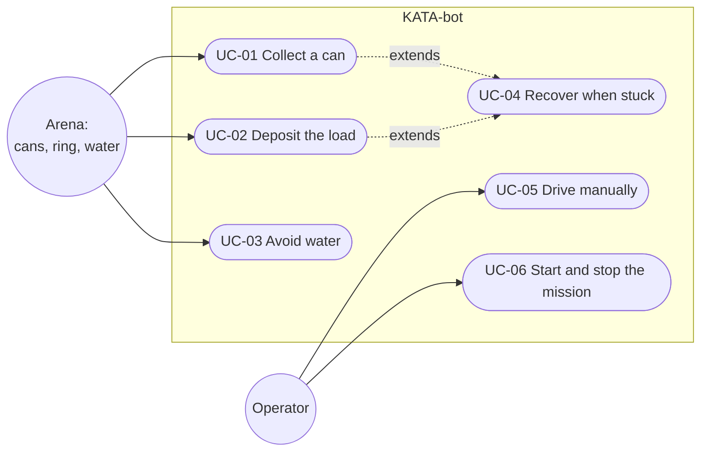
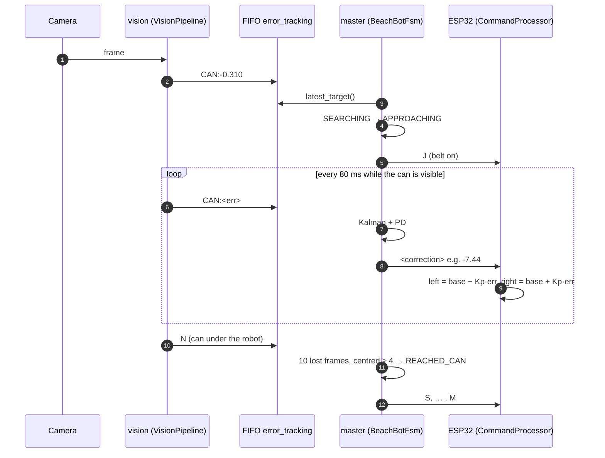
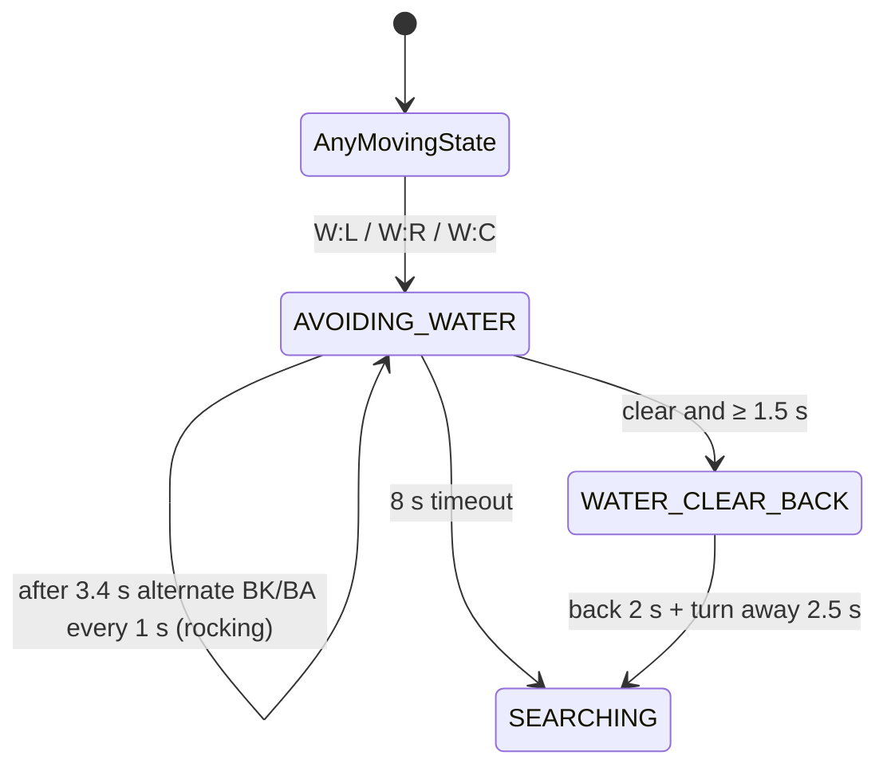

# Scenarios view (+1)

## Use-case diagram

## UC-01 Collect a can

| | |
|---|---|
| Precondition | Vision and master running; ESP32 in autonomous mode (`Z`) |
| Main flow | 1. S-pattern search. 2. Vision reports `CAN:<err>`. 3. Master starts the belt (`J`) and steers with PD. 4. The can leaves the view after ≥ 4 centred frames. 5. Stop, count +1, pause 2 s, stop the belt (`M`), search again. |
| Alternative | The can disappears before being centred: stop the belt, back to search. |
| Requirements | FR-01, 02, 05, 06, 07, 08, 14 |

## UC-02 Deposit the load

After `cans_per_deposit` cans: S-pattern search for the red ring → approach with PD until the ring is
≥ 100 px wide → curve right 3 s, back-left 1 s ("trailer" manoeuvre) → open the door (`DO`), back-left
2 s, close (`DC`) → search again. Requirements FR-03, FR-09.

## UC-03 Avoid water

Requirements FR-04, FR-10, NFR-01.

## UC-04 Recover when stuck

If the same command is sent for 40 s in a moving state: alternate back/forward every 0.2 s for 1.2 s,
then curve right for 1 s, then resume. Requirement FR-11.

## UC-05 Drive manually

The operator joins the ESP32 access point and sends one-letter commands over WebSocket (port 81).

| Key | Action | Key | Action |
|---|---|---|---|
| F / B / L / R / S | forward, back, spin left, spin right, stop | W / X | right speed ±10 |
| P / Ñ | left speed ±10 | K / k | Kp ±0.1 |
| J / M | belt on / off | Q / A | belt speed ±10 |
| Y / T | base speed ±10 | Z | toggle manual ↔ autonomous |

Driving keys and wheel tuning answer `ERROR` in autonomous mode. Requirements FR-12, FR-13.

## UC-06 Start and stop the mission

Start `vision.py` (creates the FIFOs and calibrates), then `maestro.py` (waits for the first vision data,
sends `S`, `M`, starts searching). Ctrl+C or SIGTERM sends `S`/`M` three times and closes the port. FR-15.
