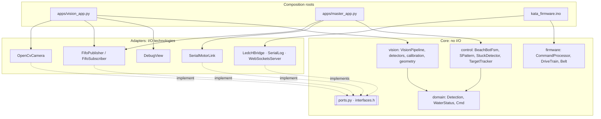
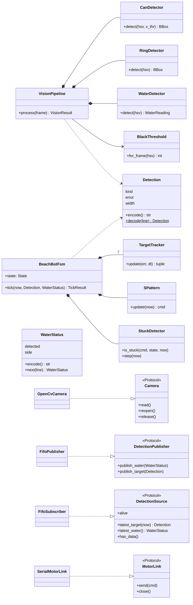
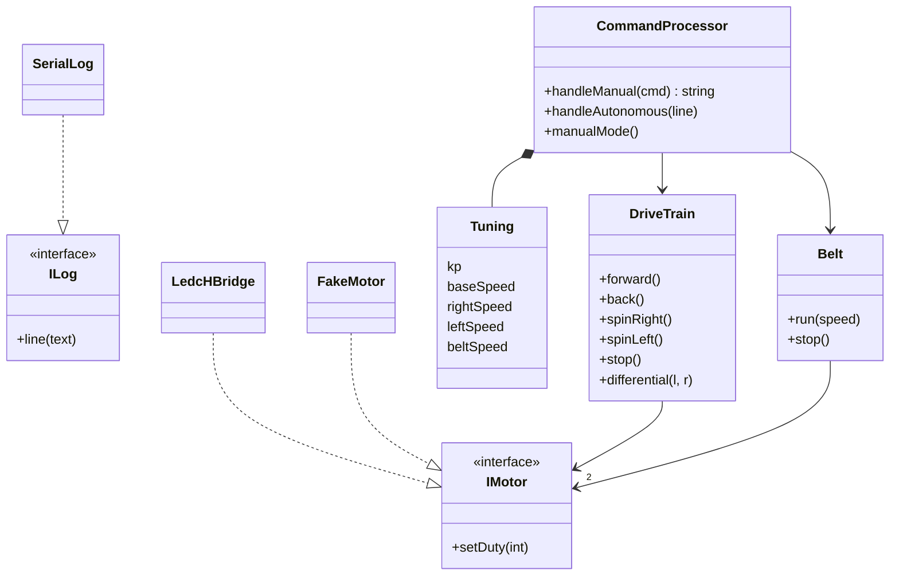
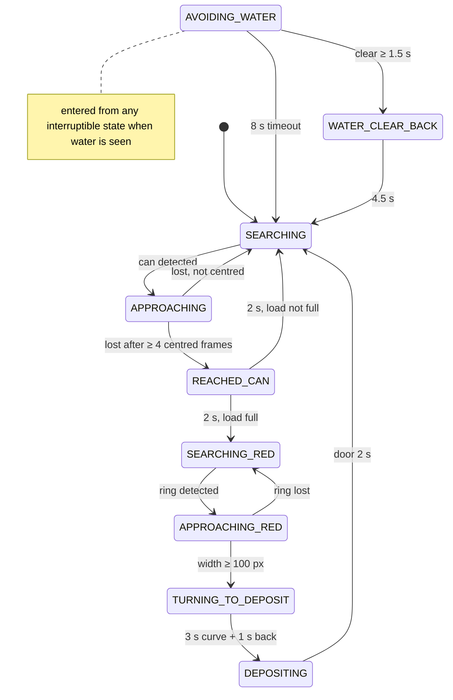

# Logical view

## 1. Layers

Dependencies always point inward. `control/` and `domain/` import nothing from OpenCV, pyserial or the OS;
`CommandProcessor` and `DriveTrain` include no Arduino header.

## 2. Raspberry Pi classes

## 3. Firmware classes

## 4. Mission state machine

## 5. Extension points

| To add… | Write | Untouched |
|---|---|---|
| A second camera (e.g. blue/water) | Another `Camera` adapter + detector | FSM |
| Ultrasonic obstacle sensor | A detector or a new field in the observation; one new FSM priority | Vision, firmware |
| Logging every message to a `.txt` | A `MotorLink` decorator that writes then forwards | FSM, serial adapter |
| ROS 2 instead of FIFOs | `DetectionPublisher` / `DetectionSource` over topics | Vision algorithms, FSM |
| Door servo / missing commands in firmware | Handlers in `CommandProcessor::handleAutonomous` + an `IServo` port | Pi software |
| Different motor driver | Another `IMotor` | `CommandProcessor` |
