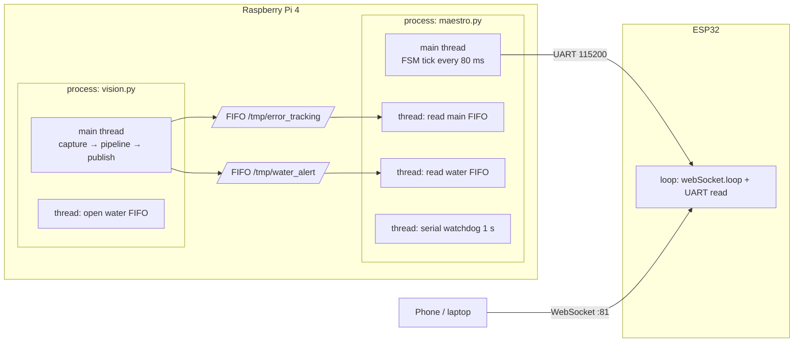
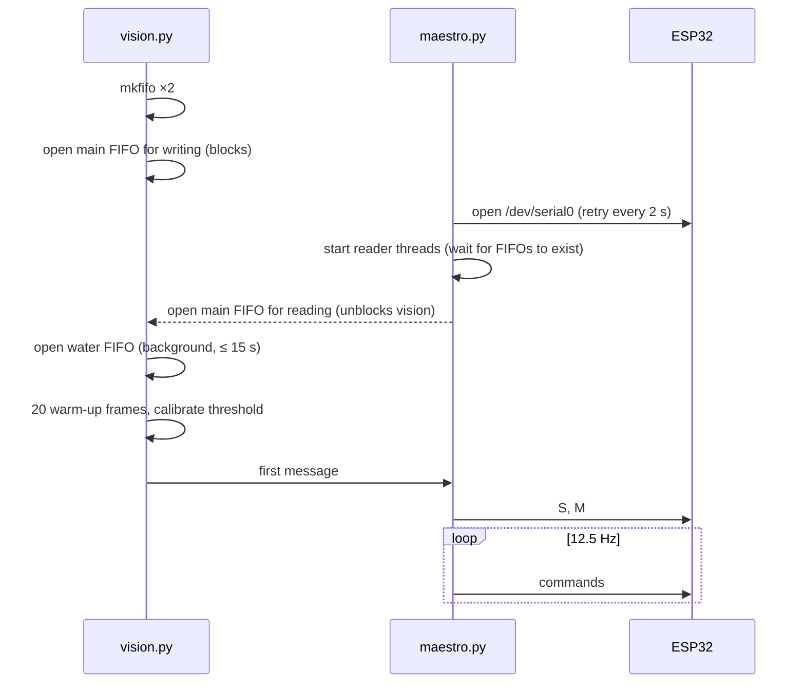

# Process view

## 1. Processes and threads

| Thread | Shares | Protection |
|---|---|---|
| Main-FIFO reader ↔ FSM | last line + timestamp | `threading.Lock` in `FifoSubscriber` |
| Water-FIFO reader ↔ FSM | `WaterStatus` (immutable value) | same lock; value replaced atomically |
| Serial watchdog ↔ FSM `send` | serial port object | `threading.Lock` in `SerialMotorLink` |
| Vision water-pipe opener ↔ main | water file object | `threading.Lock` in `FifoPublisher` |

The FSM itself is single-threaded and receives snapshots, so it needs no locks.

## 2. Start-up order

## 3. Protocols

**Vision → master, main FIFO:** `CAN:<err>` · `RED:<err>:<width_px>` · `N`. Priority: can > ring > nothing.
While water is seen, always `N`.
**Vision → master, water FIFO:** `W:L` · `W:R` · `W:C` · `C`. Written every frame, before the main message.
**Master → ESP32, UART:** a number (steering correction) or a code from `domain/commands.py`.

## 4. Known gap: commands the firmware ignores

The firmware in this repository is the March–April 2026 version recovered from the editor history.
In autonomous mode it executes only:

| Line | Firmware action |
|---|---|
| number | differential steering with `Kp` and base speed |
| `N` | spin right at base speed |
| `S` | stop |

The master also sends `F`, `CR`, `CL`, `BL`, `BK`, `BA`, `DO`, `DC`, `J`, `M`. **This firmware ignores them**,
so the S pattern, belt control, deposit manoeuvre and water back-off have no effect with this firmware
(the wheels keep the last command). The competition firmware that implemented them is not in the
repository. Implementing them is the first improvement to make: add handlers in
`CommandProcessor::handleAutonomous` and tests in `firmware/test`. The refactor deliberately does not
invent their behaviour ([ADR-0006](adr/0006-keep-wire-protocol.md)).

## 5. Failure handling

| Failure | Detection | Reaction |
|---|---|---|
| ESP32 unplugged | `SerialException` / port closed | Watchdog reopens every 1 s (retries every 2 s) |
| Vision stalls | No message for 0.5 s | Master treats it as `N` |
| Vision process exits | Main FIFO EOF | Master stops the FSM and the motors |
| Master restarts | `BrokenPipeError` on write | Vision reopens the main FIFO |
| Camera read fails | `read()` returns False | Camera re-opened |
| Robot stuck | Same command 40 s | Escape manoeuvre |
| Stuck in water | Water > 3.4 s | Alternate BK/BA; give up after 8 s |
