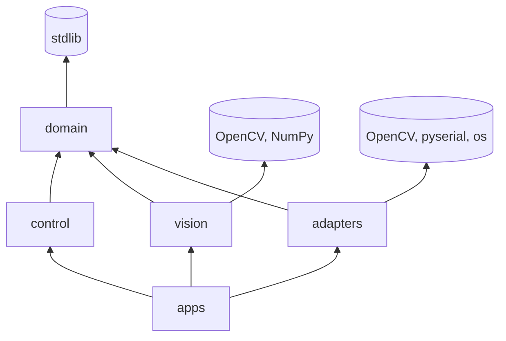

# Development view

## 1. Repository layout

```
.
├── src/kata_bot/                  Raspberry Pi software (Python package)
│   ├── config.py                  every tunable value (TMR 2026 defaults)
│   ├── ports.py                   interfaces: Camera, DetectionPublisher, DetectionSource, MotorLink
│   ├── domain/                    messages.py (vision protocol), commands.py (ESP32 protocol)
│   ├── vision/                    pipeline, detectors, calibration, geometry, debug_view
│   ├── control/                   fsm, filters (Kalman, PD), behaviours (S pattern, stuck)
│   ├── adapters/                  opencv_camera, fifo, serial_link
│   └── apps/                      vision_app.py, master_app.py (composition roots)
├── scripts/                       vision.py, maestro.py: same commands as before
├── firmware/
│   ├── esp32/kata_firmware/       Arduino sketch: .ino + config.h + logic (.h/.cpp)
│   └── test/                      host tests for the firmware logic (g++)
├── tests/                         pytest suite
│   └── reference/                 TMR 2026 scripts, used only by golden tests
├── docs/                          RUP artefacts and 4+1 views
└── assets/                        photos and videos
```

## 2. Dependency rules



- `domain` and `control` must never import `cv2`, `serial` or `os`.
- Only `apps/` creates adapters and reads the real clock.
- In the firmware, only the `.ino` includes Arduino headers.

## 3. Build, run and test

| Task | Command |
|---|---|
| Install (Pi or PC) | `pip install -e ".[dev]"` or `pip install -r requirements.txt` |
| Run vision | `python3 scripts/vision.py` (`--headless` without a display) |
| Run master | `python3 scripts/maestro.py` (`--port /dev/ttyUSB0` to override) |
| All tests | `make test` |
| Firmware | Arduino IDE → open `firmware/esp32/kata_firmware/kata_firmware.ino`, board "ESP32 Dev Module", ESP32 core 3.x, library "WebSockets" (Markus Sattler) |

## 4. Conventions

| Topic | Rule |
|---|---|
| Configuration | Add a field to a dataclass in `config.py`; never a literal in logic code |
| Time | Functions receive `now`; do not call `time.time()` outside `apps/` and adapters |
| New behaviour | New class with one responsibility + unit test; then wire it in the FSM |
| Protocol changes | Edit `domain/messages.py` or `domain/commands.py` and the firmware together, with tests on both sides |
| Golden tests | Must stay green for refactors. An intentional behaviour change updates the scenario and is recorded in `CHANGELOG.md` |
