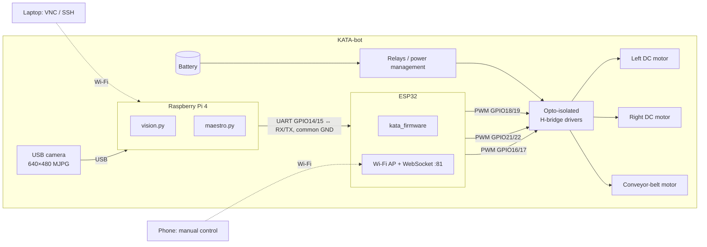

# Physical view

## 1. Deployment

## 2. ESP32 pin map

| Function | GPIO | Notes |
|---|---|---|
| Left motor IN1 / IN2 | 18 / 19 | 5 kHz, 8-bit PWM on both inputs |
| Right motor IN1 / IN2 | 21 / 22 | |
| Belt motor IN1 / IN2 | 16 / 17 | Runs reversed (`-speed`) |
| UART to the Pi | RX0 / TX0 | 115200 baud, shared with the USB console |

## 3. Replicating the robot

1. **ESP32:** flash `kata_firmware.ino` (see the development view). Optionally create `secrets.h` from
   `secrets.example.h` to change the access-point name and password.
2. **Raspberry Pi:** Raspberry Pi OS, enable the serial port without login shell (`raspi-config` →
   Interface → Serial), `pip install -r requirements.txt`.
3. **Wiring:** Pi TX → ESP32 RX, Pi RX → ESP32 TX, **common ground**. Both are 3.3 V logic.
4. **Bench test without the Pi:** join the `ESP32_CHAT` AP and send `F`, `S`, `J`, `M` over WebSocket
   to `ws://192.168.4.1:81`.
5. **Bench test the Pi without motors:** `make test`, then run vision with the camera to tune the HSV
   ranges in `vision/detectors.py` and thresholds in `config.py` for your light conditions.
6. **Arena:** checklist F-1…F-7 in the [test plan](../rup/03-test-plan.md).

**Not documented in the repository yet** (add them when known): motor and driver models, battery
voltage and capacity, relay wiring, door actuator, chassis drawings. The door commands `DO`/`DC` have no
firmware implementation here (see the process view §4).
