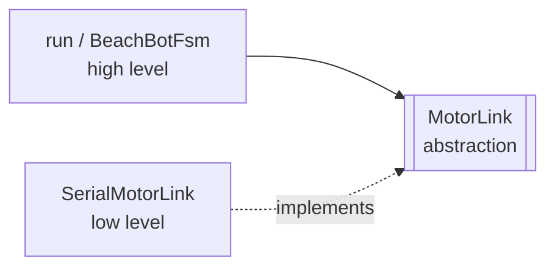

# SOLID principles in KATA-bot

## S: Single responsibility

The TMR 2026 scripts had two large loops: `vision.py` (camera, three detectors, tracking, pipes, debug
drawing) and `maestro.py` (pipes, serial, filters, nine states, shutdown). Each concern now has one module:

| Module | Its only reason to change |
|---|---|
| `vision/detectors.py` `CanDetector` | How a can looks |
| `vision/detectors.py` `WaterDetector` | How water looks |
| `vision/calibration.py` | Lighting adaptation |
| `vision/debug_view.py` | What the operator sees on screen |
| `control/filters.py` | Signal smoothing and steering law |
| `control/behaviours.py` | Search and escape manoeuvres |
| `control/fsm.py` | Mission rules |
| `adapters/fifo.py` / `serial_link.py` | Transport details |
| `firmware/.../CommandProcessor.cpp` | Meaning of each command |
| `firmware/.../DriveTrain.cpp` | How commands become wheel duties |

## O: Open/closed

- A new detector (e.g. obstacles) plugs into `VisionPipeline` without touching existing detectors.
- A new motor driver is a new `IMotor`; `CommandProcessor` does not change.
- A different transport (ROS 2, TCP) is a new `DetectionPublisher`/`DetectionSource`.
- All numbers are configuration, so tuning never edits logic.

## L: Liskov substitution

`BeachBotFsm` and `run()` work identically with `FifoSubscriber` and with the fake sources in the tests;
`CommandProcessor` works identically with `LedcHBridge` and `FakeMotor`. The golden tests are the
proof: the same scenario through real-style and fake adapters yields the same commands.

## I: Interface segregation

Four narrow Python ports instead of one "Robot" object: the vision side only knows `Camera` and
`DetectionPublisher`; the master only knows `DetectionSource` and `MotorLink`. In the firmware,
`IMotor` has one method and `ILog` has one method.

## D: Dependency inversion

High-level policy (`fsm.py`, `CommandProcessor`) depends on abstractions; concrete objects are created only
in `apps/*.py` and `kata_firmware.ino`. The clock is injected too, which is what makes the time-based
state machine testable in milliseconds.

## Deliberately not done

No plugin registry, no abstract factory, no message bus: the robot has one configuration, and plain
constructor injection is enough. Abstractions were added only where something varies or must be tested.
